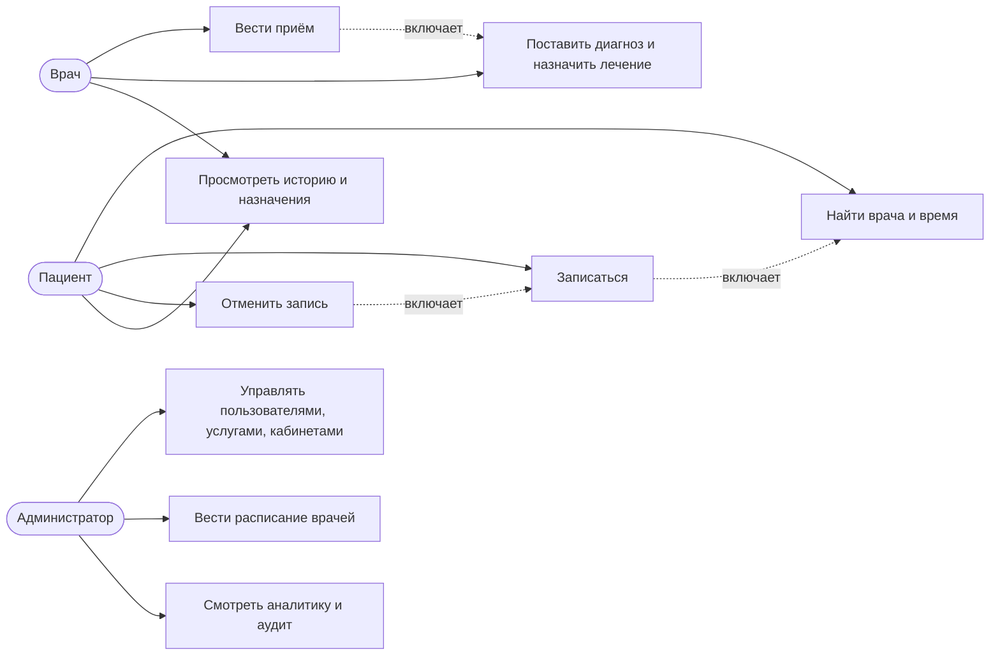
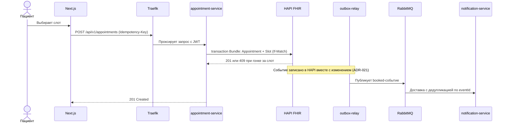

# Лайфлайн (MedCenter)

Веб-приложение медицинского центра. **Пациенты** записываются на приём онлайн, **врачи** ведут приём и оформляют
клинические документы, **администраторы** управляют пользователями, услугами, кабинетами и расписанием.

Клинические данные хранятся в **HL7 FHIR R4** (движок HAPI FHIR JPA), вход и права доступа построены на
**SMART on FHIR** (OAuth 2.0 + PKCE), а национальная терминология подключается по каноническим URL `fhir.by`.

> Учебный проект (НИР / курсовая работа, БГТУ, дисциплина «Технологии разработки веб-приложений»).
> Ориентир — клиника Республики Беларусь.

## Содержание

- [1. Бизнес-требования](#1-бизнес-требования)
- [2. Пользователи и сценарии использования](#2-пользователи-и-сценарии-использования)
- [3. Архитектура](#3-архитектура)
- [4. Соблюдаемые стандарты](#4-соблюдаемые-стандарты)
- [5. Статус реализации](#5-статус-реализации)
- [6. Запуск и проверки](#6-запуск-и-проверки)
- [7. Документация](#7-документация)

## 1. Бизнес-требования

### 1.1 Цели

- **Запись без очереди:** пациент выбирает врача, услугу и свободное время без звонка в регистратуру.
- **Единая карта пациента:** диагнозы, назначения и история приёмов ведутся в одной системе.
- **Интероперабельность:** данные хранятся в международном стандарте обмена (FHIR R4) и используют
  национальные справочники, поэтому их можно передавать другим системам.
- **Контроль доступа и подотчётность:** каждый пользователь видит только разрешённые ему данные,
  а действия фиксируются в журнале аудита.

### 1.2 Роли

| Роль | Основные цели |
| --- | --- |
| Пациент | Найти врача и услугу, записаться и отменить запись, видеть свои приёмы и назначения |
| Врач | Вести свой приём: диагноз, рекомендации, назначения; видеть своё расписание и историю пациента |
| Администратор | Заводить пользователей, услуги, кабинеты и расписание врачей; видеть аналитику и аудит |

### 1.3 Функциональные требования

Полный список (21 требование с критериями приёмки в терминах FHIR) — в
[tasks/TASK-001/requirements-analyst-requirements.md](tasks/TASK-001/requirements-analyst-requirements.md).

| Роль | Требования |
| --- | --- |
| Пациент | Вход по SMART (FR-001); поиск врачей и услуг (FR-002); поиск свободного времени (FR-003); запись (FR-004); отмена (FR-005); расписание и история (FR-006); назначения врача (FR-007); уведомления о статусе записи (FR-008) |
| Врач | Расписание и список пациентов (FR-009); история обращений (FR-010); оформление приёма (FR-011); диагноз МКБ-10 (FR-012); рекомендации (FR-013); назначения услуг и лекарств (FR-014) |
| Администратор | Пользователи (FR-015); услуги (FR-016); кабинеты (FR-017); системные настройки и терминология (FR-018); аналитика и отчёты (FR-019); расписание врачей и генерация слотов (FR-020); аудит действий (FR-021) |

### 1.4 Бизнес-правила

| ID | Правило |
| --- | --- |
| BR-001 | На один слот приходится не более одной активной записи |
| BR-002 | Отменить запись может пациент (свою) или администратор |
| BR-003 | Приём и диагноз оформляет только врач, который ведёт этот приём |
| BR-004 | Диагноз ставится в контексте приёма и ссылается на `Condition` с кодом МКБ-10 |
| BR-005 | Назначения ссылаются на диагноз и приём |
| BR-006 | Пациент видит только свои данные (компартмент `Patient`) |
| BR-007 | Справочники (услуги, кабинеты, пользователи, терминология) ведёт только администратор |
| BR-008 | Приём нельзя оформить для отменённой записи или неявки (`noshow`) |
| BR-009 | Лекарства кодируются по АТХ (ATC), единицы измерения — по UCUM |

### 1.5 Нефункциональные требования

| ID | Требование |
| --- | --- |
| NFR-001 | Микросервисы, каждый в своём контейнере, независимый деплой |
| NFR-002 | TypeScript (strict), Node.js, NestJS, Next.js, Docker |
| NFR-003 | Ресурсы соответствуют HL7 FHIR R4; публикуется `CapabilityStatement` |
| NFR-004 | Справочники привязаны по каноническим URL (`CodeSystem` / `ValueSet`) |
| NFR-005 | Поиск слотов и записей — не дольше 500 мс за счёт индексов по параметрам поиска |
| NFR-006 | TLS, SMART scopes, RBAC, компартмент пациента, журнал аудита, защита по OWASP Top 10 |
| NFR-007 | Структурные логи, health/readiness endpoints, метрики |
| NFR-008 | Интерфейс на русском языке (ru-BY), с заделом под английский |
| NFR-009 | Stateless-сервисы, горизонтальное масштабирование |
| NFR-010 | Документация: пояснительная записка, UML use-case, схема БД, структурная схема |
| NFR-011 | Тесты unit / integration / e2e, включая негативные сценарии |

### 1.6 Допущения и вне объёма

- Одна организация (single-tenant); модель допускает расширение.
- Уведомления — in-app и по e-mail; SMS и push вне объёма.
- Оплата и биллинг вне объёма.
- Врачей и администраторов создаёт администратор; пациент может зарегистрироваться сам.
- SNOMED CT и LOINC не включены из-за лицензионных ограничений; задел — через `ConceptMap`.
- Расписание обновляется по запросу, без канала реального времени; единственный источник расписания — наш FHIR-сервер.

## 2. Пользователи и сценарии использования

### 2.1 Диаграмма use-case



### 2.2 Ключевые сценарии

| ID | Актор | Сценарий | Результат |
| --- | --- | --- | --- |
| UC-01 | Пациент | Выбирает услугу и врача, находит свободный слот, подтверждает запись | `Appointment` в статусе `booked`, слот занят, пациенту уходит уведомление |
| UC-02 | Пациент, администратор | Отменяет запись | `Appointment` в статусе `cancelled` с причиной, слот освобождается |
| UC-03 | Врач | Открывает приём по записи, ставит диагноз МКБ-10, пишет рекомендации | `Encounter` в работе, `Condition` и `CarePlan` привязаны к приёму |
| UC-04 | Врач | Назначает услуги и лекарства (код АТХ, единицы UCUM) и завершает приём | `ServiceRequest` / `MedicationRequest`, `Encounter` в статусе `finished` |
| UC-05 | Пациент, врач | Смотрит историю приёмов, назначения и расписание | Списки `Bundle`, отфильтрованные по правам роли |
| UC-06 | Администратор | Создаёт врача и расписание, генерирует слоты на 90 дней вперёд | `Schedule` и идемпотентно созданные `Slot` |
| UC-07 | Администратор | Ведёт услуги, кабинеты, пользователей; смотрит отчёты и журнал аудита | CRUD-операции, агрегаты, `AuditEvent` |

### 2.3 Сценарий записи на приём



## 3. Архитектура

| Слой | Компоненты |
| --- | --- |
| Клиент | Next.js (App Router), 5 групп маршрутов по ролям, SMART PKCE через token-broker |
| Вход | Traefik: TLS и маршрутизация; JWT, scopes и RBAC проверяет общий guard-слой `libs/common` |
| Бизнес-логика | 8 NestJS BFF-сервисов: `auth`, `practitioner`, `catalog`, `patient`, `appointment`, `notification`, `encounter`, `analytics` |
| Публикация событий | `outbox-relay` (ADR-021): события пишутся в HAPI вместе с изменением и публикуются в RabbitMQ |
| Клинический движок | HAPI FHIR JPA (R4) с PostgreSQL; единственная система записи клинических данных |
| Вспомогательные хранилища | PostgreSQL (схема `auth`, read-model аналитики), Redis (кэш, rate-limit, denylist токенов), RabbitMQ |

Подробности: [specs/architect-architecture.md](specs/architect-architecture.md) (21 ADR, диаграммы в
[docs/diagrams/](docs/diagrams/)).

## 4. Соблюдаемые стандарты

Проект проектировался от стандартов, а не наоборот. Ниже перечислено, какой стандарт где применён.

### 4.1 Медицинские данные и терминология

| Стандарт | Как применяется |
| --- | --- |
| **HL7 FHIR R4** (International) | Все клинические ресурсы (`Patient`, `Appointment`, `Encounter`, `Condition`, `CarePlan`, `MedicationRequest` и др.) в версии R4; ошибки FHIR — в `OperationOutcome`; сервер публикует `CapabilityStatement` |
| **МКБ-10** (адаптация МЗ РБ) | Диагнозы в `Condition.code`, канонический URL `https://fhir.by/...` |
| **АТХ / ATC** | Коды лекарств в `MedicationRequest.medication` (BR-009) |
| **UCUM** | Единицы измерения в `Observation.valueQuantity` и `Dosage` |
| **НСИ ЦИСЗ** (через `fhir.by`) | Справочники услуг и ЛС; снапшот с импортером, привязка по canonical URL (ADR-016) |

Политика проекта: **только HL7 FHIR International R4** и национальная терминология. Проверка соответствия —
`npm run smoke:stack` и контрактные тесты против R4 (ADR-017).

### 4.2 Безопасность и аутентификация

| Стандарт | Как применяется |
| --- | --- |
| **SMART App Launch** (on FHIR) | Scopes `patient/*.read|write`, `user/*.read|write`, `launch`; discovery через `smart-configuration` |
| **OAuth 2.0** (RFC 6749) | `auth-service` — authorization server; refresh-rotation |
| **PKCE** (RFC 7636, метод S256) | Обязателен для всех клиентов; fail-closed в callback |
| **Token revocation** (RFC 7009) | Отзыв токенов (эндпоинт revocation в `auth-service`) |
| **JWT RS256 + JWKS** | Подписанные токены; ключи публикуются через JWKS |
| **OWASP Top 10** | NFR-006; тесты безопасности на scopes, RBAC и компартмент пациента (BR-006) |
| **TLS** | Все внешние соединения — через Traefik |
| **Журнал аудита** (`AuditEvent`) | Создание, изменение и удаление данных (FR-021) |
| **Закон РБ о защите персональных данных** (№ 99-З) | Согласие на обработку данных при записи; юридическая проверка формулировок — открытый пункт |

Для клиента (`frontend/`) refresh-токен не попадает в JavaScript браузера: сессия хранится в
httpOnly-cookie, access-токен — в памяти.

### 4.3 Прикладной API

| Стандарт | Как применяется |
| --- | --- |
| **RFC 7807** (Problem Details) | Все ошибки BFF-сервисов с каталогом `errorCode` |
| **RFC 3339** | Даты и время в ответах API |
| **Idempotency-Key** | `POST /appointments` защищён от повторной записи |
| **Оптимистичная блокировка** (`If-Match`, ADR-012) | Защита слота от двойного бронирования |
| **OpenAPI / Swagger** | Документация по адресу `/api/docs/<service>` (включается `SWAGGER_ENABLED`) |
| **Пагинация** | Единый конверт `PaginatedResponseDto` |

### 4.4 Интерфейс

| Стандарт | Как применяется |
| --- | --- |
| **WCAG 2.1** | Требование к доступности клиента; проверка контраста и фокуса |
| **Локализация ru-BY** | `next-intl`, русский язык по умолчанию (NFR-008) |

### 4.5 Разработка и документация

| Стандарт | Как применяется |
| --- | --- |
| **TypeScript strict** | `tsconfig.base.json` для всех проектов |
| **ESLint + Prettier** | Единые правила (одинарные кавычки, ширина строки 100) |
| **Conventional Commits** | Формат сообщений коммитов, например `fix(web): ...`, `feat(...)`, `docs(adr): ...` |
| **Semantic Versioning** и **Keep a Changelog** 1.1.0 | [CHANGELOG.md](CHANGELOG.md) |
| **Architecture Decision Records** | ADR-001…ADR-021 в [specs/architect-architecture.md](specs/architect-architecture.md) |
| **Bruno** | Коллекция API в [bruno/medcenter-api/](bruno/medcenter-api/) |
| **Docker Compose** | Все сервисы поднимаются одной командой; структура готова к Kubernetes |

## 5. Статус реализации

- **Готово:** все 8 BFF-сервисов, `outbox-relay`, клиент Next.js (роли пациента, врача и администратора),
  E2E-сценарии A–F и security-проверки Playwright, Swagger, Bruno-коллекция, демо-данные.
- **Открыто:** статус `fulfilled` в аналитике, очистка демо-данных HAPI, пояснительная записка,
  юридическая проверка текста согласия.
- История изменений — [CHANGELOG.md](CHANGELOG.md); полный список открытых пунктов —
  [tasks/TASK-001/](tasks/TASK-001/).

## 6. Запуск и проверки

### Запуск

Нужны Node.js 22 + npm и Docker с Compose. Скопируйте `.env.example` в `.env` и заполните обязательные значения
(`.env` не коммитится; опциональные ключи перечислены в комментариях `docker-compose.yml`).

```bash
npm ci
docker compose up -d --build        # 5 infrastructure containers + 8 BFF services + outbox-relay + web (15 containers)
npm run stack:wait                  # waits until the edge, HAPI (/fhir/metadata CapabilityStatement) and auth-service answer
npm run seed:terminology            # national terminology snapshot (https://fhir.by/... canonicals)
npm run seed:demo                   # demo organisation, doctors, services, rooms, schedules and 14 days of free slots (idempotent)
```

| Что | Адрес |
| --- | --- |
| Веб-клиент | <http://localhost:3000> |
| API через Traefik | `http://localhost:8081/api/v1/...` |
| Форма входа (auth-service) | открывается из веб-клиента |
| HAPI FHIR (только локально) | `http://localhost:8080/fhir` |
| Swagger UI (по умолчанию выключен) | `http://localhost:8081/api/docs/<service>` |

### Проверки

| Проверка | Команда |
| --- | --- |
| Backend unit / integration | `npm test` |
| Lint, типы | `npm run lint`, `npm run typecheck` |
| Frontend | `cd frontend && npx tsc --noEmit && npx jest && npx next lint` |
| Smoke через Traefik | `npm run smoke:stack` |
| Playwright E2E (сценарии A–F, security) | `cd frontend && E2E_BROWSER_CHANNEL=chrome npx playwright test` |

Демо-аккаунты создаются командой `npm run seed:demo -- --users --with-admin`; список учётных записей и
ручной чек-лист — в [tasks/TASK-001/verify-manual-testing-guide.md](tasks/TASK-001/verify-manual-testing-guide.md).

## 7. Документация

| Документ | Содержание |
| --- | --- |
| [specs/MANIFEST.md](specs/MANIFEST.md) | Индекс спецификаций |
| [specs/architect-architecture.md](specs/architect-architecture.md) | Архитектура, слои, ADR |
| [specs/api-designer-spec.md](specs/api-designer-spec.md) | Контракт API `/api/v1` |
| [specs/frontend-design-spec.md](specs/frontend-design-spec.md) | Клиент, маршруты, E2E-сценарии |
| [docs/diagrams/](docs/diagrams/) | Диаграммы draw.io |
| [CHANGELOG.md](CHANGELOG.md) | История изменений |
